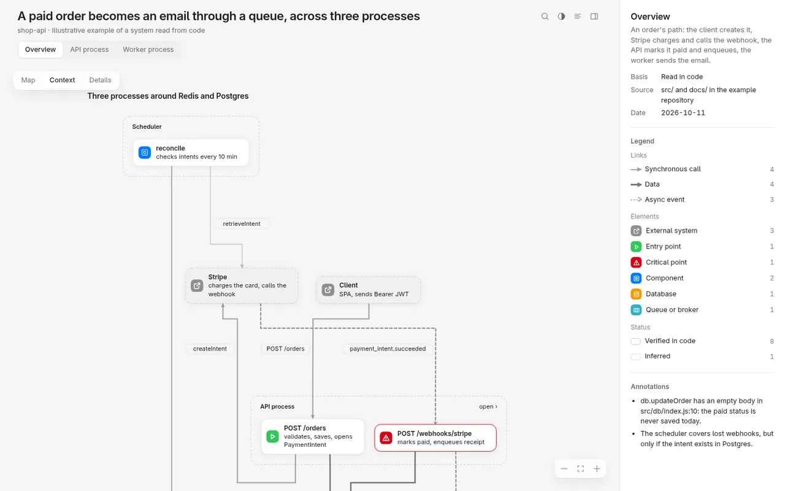
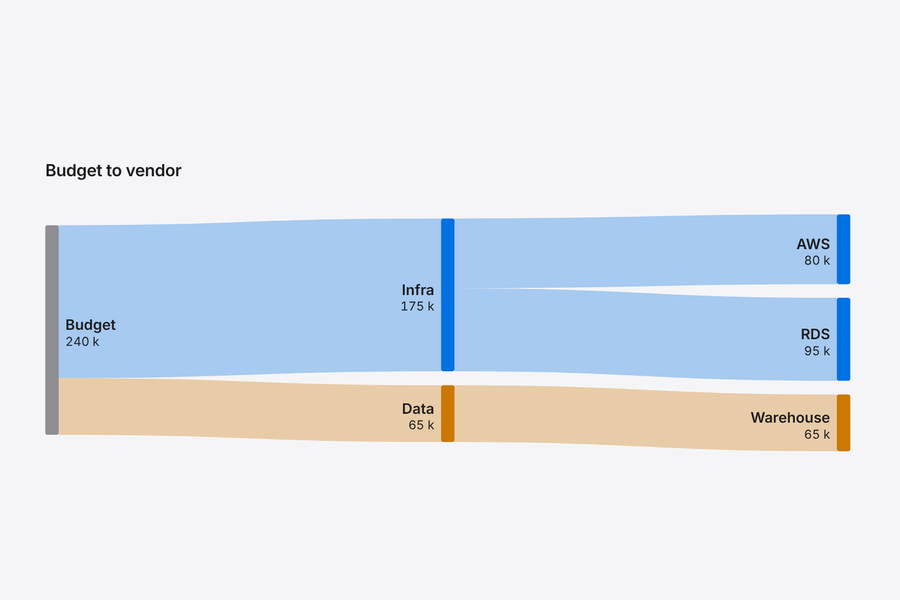
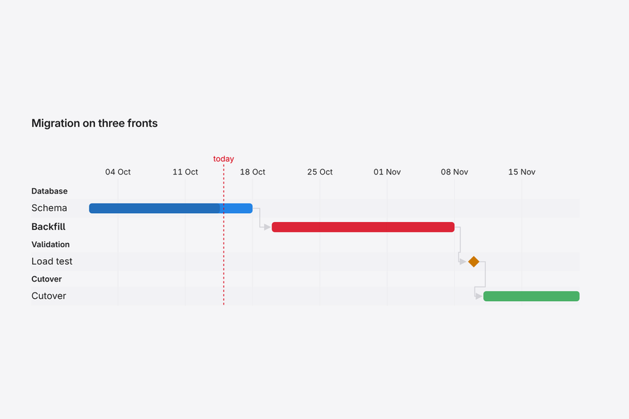
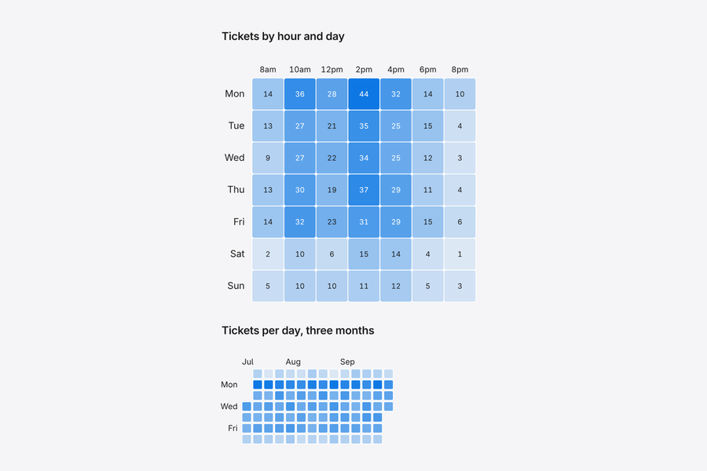
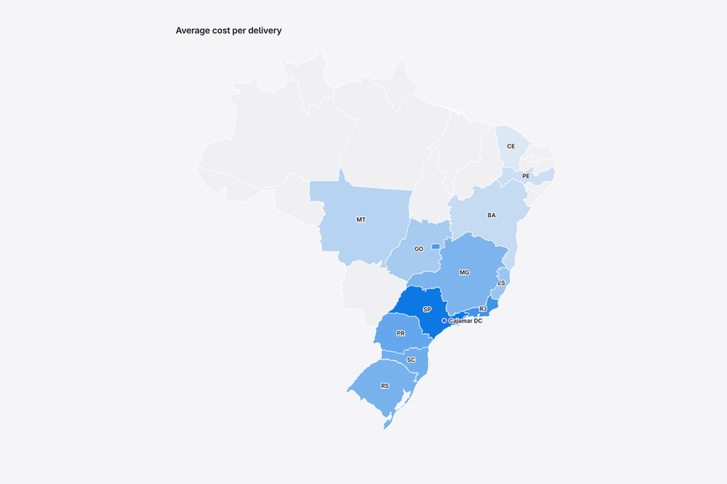
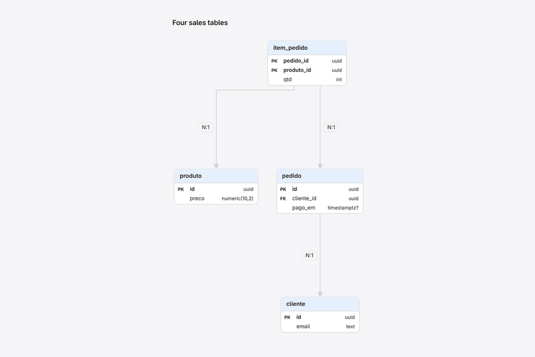
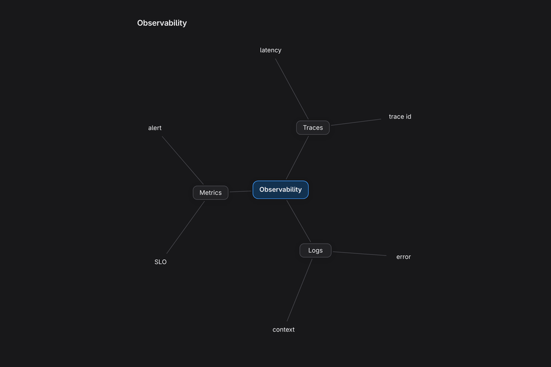
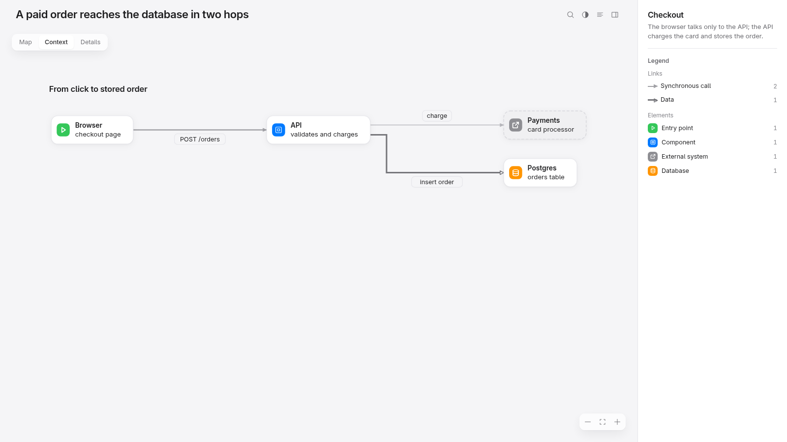

<p align="center">
  
</p>

<h1 align="center">visual-thinking</h1>

<p align="center">
  An agent skill that answers with a picture you can click.
</p>

<p align="center">
  <a href="LICENSE"></a>
  
  
  
</p>

<p align="center">
  <a href="#install">Install</a> ·
  <a href="#use-it">Use it</a> ·
  <a href="#what-it-draws">What it draws</a> ·
  <a href="#build-a-page-yourself">Build a page</a> ·
  <a href="#examples">Examples</a>
</p>

Ask your coding agent how something works, which option to pick or what the numbers say. It builds one HTML page: a canvas to pan and zoom, where clicking any element explains it in a side panel.

<p align="center">
  
</p>

## Install

```bash
npx skills add EuCaue/visual-thinking
```

Or clone it into your agent's skills folder:

```bash
git clone https://github.com/EuCaue/visual-thinking ~/.claude/skills/visual-thinking
```

Or download the zip from [Releases](https://github.com/EuCaue/visual-thinking/releases) and unzip it there.

That path is for Claude Code. For Codex and other agents that read skills, clone it into `~/.agents/skills/` instead. Building pages needs Python 3, with no packages to install.

## Use it

Ask for what you want to see. The skill takes over when a drawing beats a few paragraphs of text, and the agent replies with the path to the page.

| You ask | You get |
|---|---|
| "How does a paid order turn into a receipt email in this repo?" | The architecture as a graph, one view per process, file paths and callers on click ([example](examples/01-architecture.json)) |
| "Postgres, MongoDB or DynamoDB for our catalog?" | A comparison table, the trade-offs per option, and where each one fits ([example](examples/02-tech-comparison.json)) |
| "Kafka, RabbitMQ or SQS? Throughput matters most." | A weighted decision matrix with weights you can drag and see the winner change ([example](examples/11-architecture-decision.json)) |
| "Did the catalog cache fix our p95?" + a CSV | Line charts with the SLO, the deploy marked, and the reason it moved ([example](examples/03-time-series.json)) |
| "Plan the database migration" | A Gantt chart with dependencies and the critical path ([example](examples/14-schedule.json)) |

Short questions still get short answers. The agent skips the page when one sentence would do.

## What it draws

The agent picks the shape that fits the question. A few of the 28 blocks:

<table>
  <tr>
    <td width="33%"><br><b>Flows</b><br><sub>where money, traffic or users go</sub></td>
    <td width="33%"><br><b>Plans</b><br><sub>tasks, dependencies, today's date</sub></td>
    <td width="33%"><br><b>Heatmaps</b><br><sub>a value per hour, day or pair</sub></td>
  </tr>
  <tr>
    <td width="33%"><br><b>Maps</b><br><sub>values per country or state</sub></td>
    <td width="33%"><br><b>Data models</b><br><sub>tables, keys and relations</sub></td>
    <td width="33%"><br><b>Mind maps</b><br><sub>ideas around one center</sub></td>
  </tr>
</table>

Plus architecture graphs, comparison tables, weighted decisions, charts, timelines, steps, code and formulas. When nothing fits, the agent draws its own SVG.

## What you can do on a page

- **Click anything** to read its details, source file and connections in the side panel. Press `Esc` to clear.
- **Switch the detail level** on diagrams: names only, responsibilities, or files.
- **Search** with `/`. Matches stay lit, everything else fades.
- **Read it as text** with the text-mode button. Phones open in this mode, and screen readers get it too.
- **Share a link** to a single element. Selecting something puts it in the URL.
- **Export** PNG or SVG from the right-click menu.

Pages work offline, follow the system's light or dark theme, and fit a phone screen. Hold `Alt` (`Option`) and drag to select text on the canvas.

## Build a page yourself

The agent writes a scene, a small JSON file that describes what to draw, and runs the builder. You can do the same to tweak a page by hand or to render one in CI.

<details>
<summary>The scene behind the page below: <code>examples/00-hello.json</code></summary>

```json
{
  "title": "A paid order reaches the database in two hops",
  "summary": "The browser talks only to the API; the API charges the card and stores the order.",
  "lang": "en",
  "views": [{
    "id": "main",
    "title": "Checkout",
    "blocks": [{
      "type": "graph",
      "id": "flow",
      "title": "From click to stored order",
      "nodes": [
        { "id": "web", "label": "Browser",  "sub": "checkout page",        "kind": "entry" },
        { "id": "api", "label": "API",      "sub": "validates and charges", "kind": "component" },
        { "id": "pay", "label": "Payments", "sub": "card processor",       "kind": "external" },
        { "id": "db",  "label": "Postgres", "sub": "orders table",         "kind": "store" }
      ],
      "edges": [
        { "from": "web", "to": "api", "label": "POST /orders", "main": true },
        { "from": "api", "to": "pay", "label": "charge" },
        { "from": "api", "to": "db",  "label": "insert order", "kind": "data", "main": true }
      ]
    }]
  }]
}
```

</details>

```bash
python3 scripts/build-scene.py examples/00-hello.json --open
```

This writes `examples/00-hello.html` next to the scene and opens it in your browser:



A mistake stops the build and names what is wrong. Here an edge points at a node that doesn't exist:

```text
scene.json: view 'main' · block 'flow': edge has no valid 'to': {"from": "api", "to": "cache", "label": "charge"}
scene.json: 1 problem(s); scene not built. Fix or remove what does not make sense.
```

Useful flags: `--validate-only` checks without writing a page. `--cdn` makes a lighter file that loads its libraries from the internet. The interface language comes from the scene's `lang`, or from the reader's browser when the scene has none.

## Examples

Every example is a scene in [`examples/`](examples) with its built page beside it. Clone the repo and open any `.html` file. These copies load their libraries from a CDN to keep the repo small.

- [`18-catalog`](examples/18-catalog.json): one of every block, from graphs and tables to maps and code.
- [`01-architecture`](examples/01-architecture.json): an overview plus one view per process.
- [`12-scenario-analysis`](examples/12-scenario-analysis.json): the same migration under pessimistic, base and optimistic scenarios.
- [`13-data-model`](examples/13-data-model.json): tables, keys and relations.
- [`15-budget-flow`](examples/15-budget-flow.json): where the money goes, as a Sankey and a treemap.
- [`19-sketch`](examples/19-sketch.json): the hand-drawn style for early ideas.
- [`21-custom-drawing`](examples/21-custom-drawing.json): what the agent draws when no built-in block fits.

## Good to know

- The agent doesn't make up numbers. With no real data in reach, it draws the structure and marks values as unknown, or asks you for them.
- The first build downloads the libraries once into `.vt-libs/`, so it needs a connection. After that, building and viewing work offline.
- Two helpers write scenes for you. `scripts/extract-deps.py <repo>` drafts a graph from real imports in Python, JS/TS or Go. `scripts/scene-diff.py before.json after.json out.json` marks what changed between two versions.

## Learn more

- [SKILL.md](SKILL.md): how the agent decides when and what to draw.
- [formats.md](formats.md): every block and its fields.
- [design.md](design.md): the visual rules the pages follow.
- [CONTRIBUTING.md](CONTRIBUTING.md): building, testing and adding blocks.

MIT licensed.
