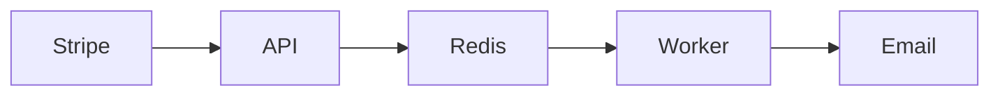
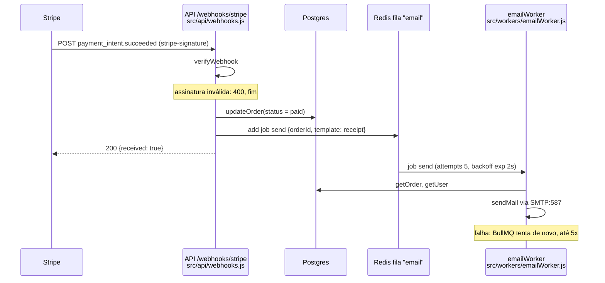
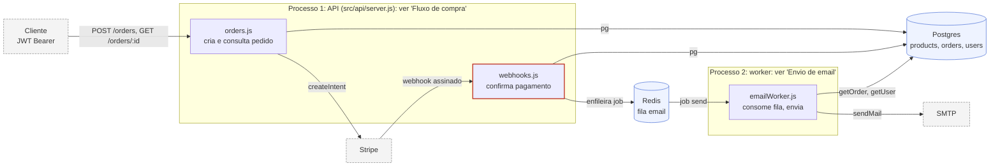
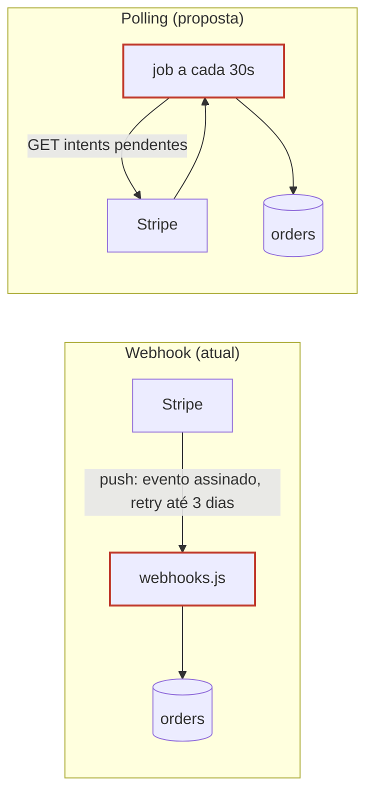

# Examples: generic versus annotated

Same subject each time. Left is what agents draw by default; right is what the skill asks for. The diagrams below are written as Mermaid so they fit in this file; the deliverable to the user is a page from `templates/` (canvas, composed SVG or Mermaid viewer), with the same nodes, labels and annotations. The scenes in `examples/` are the reference pages: `01-arquitetura.json` holds an overview plus two process views, `02-comparacao-tecnologias.json` a matrix with cards and a spectrum, and so on; `sh scripts/build-examples.sh` renders them.

## 1. Boxes and arrows versus a mechanism the reader can follow

**Request:** "Não entendi, faz um desenho de como o email de recibo é enviado."

**Bad: generic flowchart.** Node names only, arrows mean "somehow related", nothing says where it fails or which file to open.

**Good: sequence with labeled edges, failure exits and file references.**

### Pedido pago gera email via fila, em dois processos

- A API nunca envia email. Ela marca o pedido e enfileira; a resposta ao Stripe volta antes do envio.
- O worker é outro processo (`node src/workers/emailWorker.js`). Parado, o job espera no Redis.
- `orderId` vem de `metadata` do PaymentIntent, gravado em `createIntent` (`src/services/payments.js`).
- Inferido: webhook duplicado do Stripe gera dois emails; não há checagem de idempotência em `webhooks.js`.

Why the second one works: each edge says what moves, the two exits (400, retry) are drawn where they happen, every participant names its file, and the one inference is tagged.

## 2. Whole system in one drawing versus overview plus detail

**Request:** "Desenhe a arquitetura atual."

**Bad:** one diagram with two processes, four external systems, eight modules, crossing lines, followed by forty lines of prose listing every module again.

**Good:** an overview with grouped boundaries and at most ten nodes, then one sub-diagram per group that matters. The overview is the map; its group labels are the titles of the sub-diagrams.

### Visão geral: API e worker só se falam pelo Redis

- Verificado: `updateOrder` em `src/db/index.js` é stub; status `paid` não persiste hoje.
- Verificado: `jsonwebtoken` usado em `auth.js` sem constar em `package.json`.
- Sub-diagramas: "Fluxo de compra" (POST /orders até 201 ou 502), "Envio de email" (example 1).

Then each sub-diagram follows, small, with its own annotations.

## 3. Option list versus a comparison the reader can point at

**Request:** "Compare webhook e polling visualmente. Não quero ler muito."

**Bad:** two unconnected boxes labeled "Webhook" and "Polling", each with a bullet list inside, followed by three paragraphs and a recommendation.

**Good:** same layout for both options, the edge that differs highlighted, then a criteria table and one-sentence conclusion.

### Quem detecta o pagamento: Stripe avisa, ou o app pergunta

| | Webhook | Polling |
|---|---|---|
| Latência | segundos | até 30s |
| Chamadas sem novidade | 0 | 1 por pedido pendente a cada 30s |
| Servidor fora do ar | Stripe reenvia (backoff, 3 dias) | job pega tudo ao voltar |
| Código a manter | handler idempotente | loop, estado, rate limit |

Manter webhook; adicionar reconciliação a cada 5 min para pendentes há mais de 2 min.

## 4. A question that does not need a drawing

**Request:** "Por que o webhook usa `express.raw()` em vez de `express.json()`?"

**Bad:** a flowchart of the middleware chain.

**Good:** two sentences. The Stripe signature is computed over the exact bytes of the body; `express.json()` parses and re-serializes, so the bytes no longer match and verification fails. `express.raw()` keeps the buffer intact for `constructEvent`.
