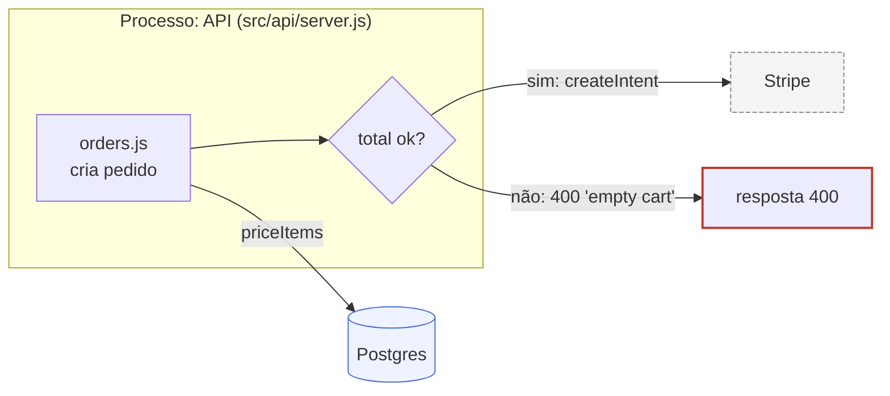
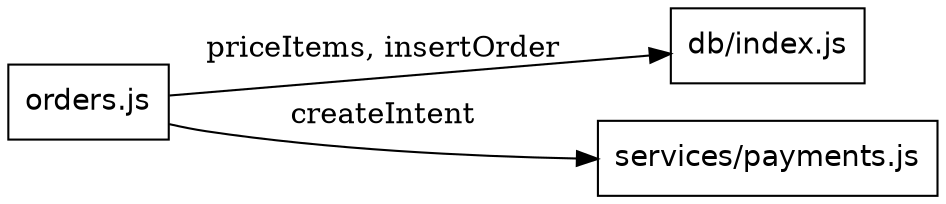

# Formats and media

## Detect what renders

| Surface | Renders | Use |
|---|---|---|
| Chat that renders Markdown with Mermaid (claude.ai, GitHub, most docs sites) | fenced `mermaid` | Mermaid inline |
| Harness with an inline widget tool (`show_widget` or similar) | SVG, HTML | hand-written SVG for custom layouts, Mermaid otherwise in a file |
| Harness with a file-send or artifact tool that lists Mermaid, SVG, HTML as renderable | files | write `.md`, `.svg` or `.html`, then send or publish |
| Terminal only, no renderer | text | ASCII, last resort |
| `mmdc`, `d2`, `dot` on PATH (check with `command -v`) | files to SVG | only when the user asks for an exported image or the repo already stores diagrams that way |

When the user needs to keep, share, or edit the result, write a file even if the chat also renders it.

## Mermaid

Default when it renders. Keep one diagram under about 12 nodes; split otherwise.



Conventions:

- `subgraph` for a boundary (process, service, host). Title names the boundary and its file.
- `[(...)]` for stores and queues, `{...}` for decisions, `[...]` for components, `((...))` for events.
- Quote labels that contain `:`, `(`, `)` or `/`.
- `;` ends a statement anywhere, including inside a sequence message or an edge label. Use `,` instead.
- `%%` comments go on their own line.
- Line breaks inside a node: `<br/>`.
- `sequenceDiagram` for time order; `Note over X: ...` for failure exits; `-->>` for replies.
- `stateDiagram-v2` for lifecycles; put guards on transitions (`pending --> paid : webhook ok`).
- `timeline` for calendar order; `mindmap` for loose ideas; `classDiagram` only for real type relations.
- Direction: `LR` for flows, `TB` for layers and trees.

## D2

Use when Mermaid layout fights you (nested boundaries, many edges) and the result will be rendered to a file. Needs `d2` on PATH.

```d2
direction: right
api: "API\nsrc/api/server.js" { orders; webhooks }
redis: Redis { shape: cylinder }
worker: emailWorker
api.webhooks -> redis: enfileira job
redis -> worker: job send
```

Render: `d2 diagram.d2 diagram.svg`.

## Graphviz

Use for dependency graphs and anything with automatic layout of many edges. Needs `dot` on PATH.



Render: `dot -Tsvg deps.dot -o deps.svg`.

## Hand-written SVG

Use for layouts the generators cannot express: timelines with bands, annotated screens, side-by-side with aligned rows.

- `viewBox="0 0 W H"`, CSS `max-width:100%; height:auto`. Size to the content.
- Strokes and text in `currentColor`; one literal hue for the element that carries meaning.
- Arrowheads via `<defs><marker>` and `marker-end="url(#arrow)"`.
- Text 11 to 13px at drawn scale, short labels; sentences go in the caption.
- Align to a grid; shared baselines, even gaps.
- No `<script>`, `<style>` blocks, `<foreignObject>`, or external images.
- Wrap in `<figure>` with `<figcaption>` stating the one claim the figure makes.

## HTML/CSS

Only when interaction adds something the reader uses: toggling layers, stepping through a sequence, hovering for file references. Static content stays Mermaid or SVG.

## ASCII

Last resort. Rules: monospace fence, boxes aligned on a column grid, every arrow labeled on the same line, one diagram per fence, under 60 columns wide so it survives narrow panes.
